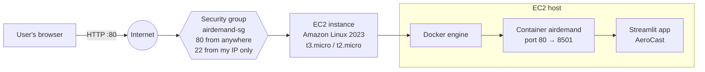

# Deploying AeroCast on AWS EC2 (manual steps)

This guide puts the AeroCast Docker container on a single free-tier EC2 instance.
Total time: about 20–30 minutes. For an automated version, see
`deploy/CLAUDE_CODE_DEPLOY_PROMPT.md`.

**Deployment contract** (do not change — the automated prompt relies on it):
`Dockerfile` at the repo root · Streamlit on port **8501** · `GET /_stcore/health` returns `ok` ·
`PROJECT_COURSE=vcc` shows the VCC team · Python package folder `airdemand/`.

## Architecture



## 1. Launch a free-tier instance

AWS Console → **EC2 → Launch instance**:

| Setting | Value |
|---|---|
| Name | `airdemand` (add tag `Project = air-demand-forecasting`) |
| AMI | Amazon Linux 2023 (x86_64) |
| Instance type | `t3.micro` or `t2.micro` (whichever is marked *Free tier eligible* in your region) |
| Key pair | Create new → `airdemand-key`, type RSA, `.pem`. Download it and keep it **out of the repo** |
| Storage | 20 GiB gp3 (free tier covers up to 30 GiB) |

Region suggestion: `ap-south-1` (Mumbai).

## 2. Security group (the instance's firewall)

Create `airdemand-sg` with these inbound rules:

| Type | Port | Source | Why |
|---|---|---|---|
| SSH | 22 | **My IP** | only you can log in |
| HTTP | 80 | 0.0.0.0/0 | anyone can open the dashboard |

Everything else is blocked by default. Port 8501 is **not** opened: Docker maps public port 80 to
the container's 8501, so the app's internal port is never exposed directly.

## 3. Connect, install Docker + Git, add 2 GB swap

```bash
# on your laptop (macOS/Linux) — the key must be private to you
chmod 400 airdemand-key.pem
ssh -i airdemand-key.pem ec2-user@<PUBLIC-IP>
```
(Windows: use PowerShell's `ssh`, and restrict the key with
`icacls airdemand-key.pem /inheritance:r /grant:r "$($env:USERNAME):(R)"`.)

On the instance:
```bash
sudo dnf update -y
sudo dnf install -y docker git
sudo systemctl enable --now docker
sudo usermod -aG docker ec2-user        # run docker without sudo (log out and back in)

# 1 GB RAM is tight for building the image: add 2 GB of swap
sudo dd if=/dev/zero of=/swapfile bs=1M count=2048
sudo chmod 600 /swapfile
sudo mkswap /swapfile && sudo swapon /swapfile
echo '/swapfile swap swap defaults 0 0' | sudo tee -a /etc/fstab
exit                                     # then ssh in again
```

## 4. Clone, build, run

```bash
git clone https://github.com/ritipshah/air-demand-forecasting.git ~/app
cd ~/app
docker build -t airdemand:latest .
docker run -d --name airdemand --restart unless-stopped \
  -p 80:8501 -e PROJECT_COURSE=vcc airdemand:latest
```
(Alternative: `docker compose up -d --build` if the compose plugin is installed.)

## 5. Verify

```bash
docker ps                                   # STATUS should become "Up … (healthy)"
curl http://localhost:8501/_stcore/health   # on the instance -> ok
```
From your laptop: `curl http://<PUBLIC-IP>/_stcore/health` → `ok`, then open
`http://<PUBLIC-IP>` in a browser. The About tab and footer should show the VCC team.

Screenshots worth taking for the report: EC2 instance page, security-group inbound rules,
`docker ps` output, the live dashboard.

## 6. Updating the app

```bash
ssh -i airdemand-key.pem ec2-user@<PUBLIC-IP>
cd ~/app && git pull
docker build -t airdemand:latest .
docker rm -f airdemand
docker run -d --name airdemand --restart unless-stopped -p 80:8501 -e PROJECT_COURSE=vcc airdemand:latest
docker image prune -f                       # remove the old image layers
```

## 7. Teardown and cost notes

* **Stop** the instance when not presenting (no compute charge while stopped; the disk still counts
  towards the free-tier storage).
* **Terminate** after grading: EC2 → Instances → Terminate; then delete the security group and the
  key pair (EC2 → Key pairs). Delete the local `.pem` too.
* Free tier: 750 instance-hours/month of t2.micro/t3.micro for eligible accounts and 30 GiB of EBS.
  Since February 2024 AWS charges for **public IPv4 addresses** (about $0.005/hour, ≈ $3.6/month)
  unless covered by your free-tier offer — check *Billing → Free tier* and terminate when done.
* An **Elastic IP** is only needed if you want the address to survive stop/start; it costs money when
  not attached to a running instance — skip it for a class demo.
* Set a **budget alert** (Billing → Budgets → $1) so any surprise charge emails you.

## 8. Troubleshooting

| Symptom | Fix |
|---|---|
| Browser times out | Security group missing the port-80 rule, or you used `https://` |
| `permission denied … docker.sock` | Log out and in again after `usermod -aG docker` |
| Build killed / very slow | Swap not active: `free -h` should show 2 GB swap |
| Container `unhealthy` | `docker logs airdemand` — the first page load fits models and takes a few seconds |
